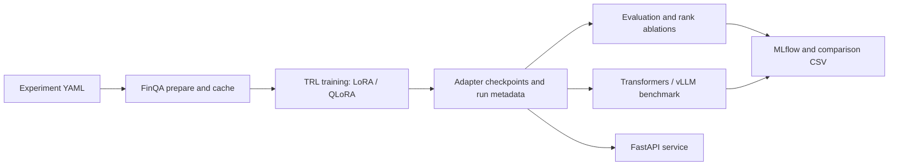

# Efficient LLM Fine-Tuning & Inference Optimization

Research code for controlled FinQA fine-tuning and inference experiments with
`Qwen/Qwen2.5-1.5B-Instruct`. The repository provides baseline evaluation,
LoRA/QLoRA training, fixed-seed rank ablations, MLflow tracking, Transformers
and vLLM benchmarks, and a FastAPI deployment surface.

**Local feasibility demonstrated:** CPU LoRA pilots finish within the local
30-minute target. The latest protocol-v2 run took **9.69 minutes**; held-out answer
loss fell from **3.101 to 1.713**, and the adapter completed all eight responses
within the generation cap. Answer accuracy remains **0/8**. See
[measured pilot results](#local-feasibility-results) for protocols and limitations.
The full Qwen study and GPU benchmarks have not been run.

Start locally with [the pilot notebook](notebooks/local_pilot.ipynb); the main
experiment remains a separate, larger study.

## Study Design

| Factor | Protocol |
| --- | --- |
| Base model | Qwen2.5-1.5B-Instruct; record an immutable Hugging Face revision for each study |
| Dataset | FinQA authors' train/dev/test JSON at a pinned source commit; persist normalized splits and a source manifest before runs |
| Methods | Zero-shot base model, LoRA, and 4-bit NF4 QLoRA |
| Adapter ablation | Rank 8, 16, 32; same configured seeds and all other settings held fixed |
| Training outputs | Adapter checkpoint, tokenizer, train/eval loss, duration, peak allocated/reserved VRAM, runtime manifest |
| Evaluation | Greedy generation; numeric answer accuracy with a documented relative tolerance; teacher-forced eval loss |
| Inference | Fixed prompt slice, warm-up excluded, configurable batch sizes, Transformers vs. vLLM, optional quantization |
| Tracking | MLflow parameters, scalar metrics, runtime metadata, and JSON artifacts |

The numeric accuracy here is a normalized numeric-answer metric, not a claim of
official FinQA benchmark parity. Preserve the generated prediction files and
state this scoring rule when reporting results. Inference p50/p95 are measured
generation-batch-call latencies for the configured batch size, not per-token
latencies. Throughput includes only measured generation calls and excludes
model loading and warm-up.

### Full Qwen study results (not run)

| Method | Rank | Seed(s) | Numeric accuracy | Train loss | Eval loss | Train time | Train / eval peak VRAM | Inference throughput | p50 / p95 latency |
| --- | ---: | --- | ---: | ---: | ---: | ---: | ---: | ---: | ---: |
| Base model | N/A | N/A | Not run | N/A | Not run | N/A | N/A / Not run | Not run | Not run |
| LoRA | 8 / 16 / 32 | Not run | Not run | Not run | Not run | Not run | Not run / Not run | Not run | Not run |
| QLoRA | 8 / 16 / 32 | Not run | Not run | Not run | Not run | Not run | Not run / Not run | Not run | Not run |

Replace “Not run” only with values from `outputs/`, the MLflow run store, and
benchmark JSON files. Keep each row tied to its model/dataset revisions, seed,
method, rank, batch size, backend, quantization, and hardware manifest.

## Local feasibility results

### Historical protocol v1

Measured on 2026-10-30 using CPU-only PyTorch on the Windows laptop. The pilot uses
`HuggingFaceTB/SmolLM2-135M-Instruct`, rank-8 LoRA on q/v projections, seed 42,
192-token sequences, answer-only targets and completion-only loss. It ran 24
single-example optimizer steps, consuming 24 examples from a 32-example training
pool. Both models were evaluated on the same eight seeded FinQA dev examples.

| Metric | Baseline | After LoRA |
| --- | ---: | ---: |
| Held-out answer-token loss | 3.848 | 2.467 |
| Completion perplexity | 46.92 | 11.78 |
| Custom numeric accuracy | 0/8 | 0/8 |
| Generations reaching the 24-token cap | 8/8 | 8/8 |
| Evaluation wall time (loss + generation) | 63.50 s | 75.82 s |

Total runtime was **406.30 s (6.77 minutes)**; training took **124.18 s**. The
adapter trained **460,800 parameters**, or **0.341%** of the wrapped model. These
measurements describe one CPU pilot, not a controlled speed comparison.

The [tracked result snapshot](reports/local-pilot-v1.json) records the measured
values, revisions, source checksums, held-out IDs and runtime metadata. Full local
artifacts are in `outputs/local-pilot/20261030T142305282861Z/` (Git-ignored).

**What this shows:** the local training, evaluation and adapter-saving pipeline
works, and held-out target loss decreased in this run. **What remains unresolved:**
answer accuracy did not improve; all generations were cut off at the short cap;
tail truncation can remove evidence and instructions. Eight examples and one seed
do not establish reasoning quality. The custom numeric matcher is not official
FinQA execution scoring, and these results do not describe the larger Qwen model.

### Current protocol v2

Measured on 2026-10-30 using CPU-only PyTorch, the same pinned 135M model, seed 42,
24 single-example training steps and **the same eight held-out dev IDs**. Protocol
v2 preserves the complete question, answer instruction and chat framing; selects
evidence by question-term overlap without using reference answers; and uses a
384-token sequence budget with up to 64 generated tokens. It also requires a
complete answer instead of extracting incidental numbers from prose.

| Metric | Baseline | After LoRA |
| --- | ---: | ---: |
| Held-out answer-token loss | 3.101 | 1.713 |
| Completion perplexity | 22.22 | 5.55 |
| Strict numeric/percent accuracy (8 references) | 0/8 | 0/8 |
| EOS-stopped responses | 6/8 | 8/8 |
| Generations reaching the 64-token cap | 2/8 | 0/8 |
| Strict answer parse failures | 8/8 | 7/8 |
| Prompts with some evidence omitted | 8/8 | 8/8 |
| Evaluation wall time (loss + generation) | 135.37 s | 97.36 s |

Total runtime was **581.29 s (9.69 minutes)** using cached model/data; training took
**294.43 s**. Parameter counts are unchanged from v1. The references contain four
numeric and four percentage answers; no yes/no or textual references were sampled,
so those categories have no measured accuracy in this run.

The [tracked v2 snapshot](reports/local-pilot-v2.json) includes individual predictions,
parsing outcomes, evidence budgets, stop reasons and provenance. The full local run
is `outputs/local-pilot/20261030T145010422275Z/`. For example, one adapted response
was `Final answer: 10.4%` against `9.9%`: a completed, parsed, incorrect answer.
Other responses include currency, units or expressions that the strict scorer does
not accept; parsing failure is not automatically evidence of failed arithmetic.

The adapter completed its responses and reduced held-out loss in this run, but
**correct financial answers are still unproven**. Question-ranked evidence is a
simple heuristic and can omit required facts; omission counts do not establish
whether the needed facts were lost. The next priorities are financial number/unit
normalization and an audit of evidence coverage before expanding the evaluation.
Protocol v2 changes prompting, context length, generation allowance and scoring;
do not interpret differences from v1 as a controlled quality or speed comparison.

## Architecture



```text
configs/experiment.yaml       Shared model, data, training, adapter, and benchmark settings
src/llm_finetuning/data.py    FinQA normalization, revision checks, prepared dataset artifacts
src/llm_finetuning/training.py TRL SFT, resumable checkpoints, loss/time/VRAM tracking
src/llm_finetuning/evaluation.py Numeric scoring, eval loss, prediction artifacts
src/llm_finetuning/experiments.py Baseline comparison and controlled rank/seed grid
src/llm_finetuning/benchmark.py Transformers/vLLM throughput and latency benchmarks
src/llm_finetuning/api.py     FastAPI single/batch generation and health endpoints
tests/                        CPU-only behavior and API contract tests
```

## Runtime

Use Python 3.10+; Python 3.12 is the tested project target. The full training
and serving stack is designed for Linux with a CUDA-capable NVIDIA GPU. QLoRA
uses Linux `bitsandbytes`; vLLM is an optional Linux/CUDA backend. The checked-in
config pins the model/tokenizer to Hub commit
`989aa7980e4cf806f80c7fef2b1adb7bc71aa306` and the original FinQA GitHub JSON
source to commit `0f16e2867befa6840783e58be38c9efb9229d742`. Change these only as
an explicit experiment factor and retain the exact revisions with the results.
The FinQA Hub builder currently fetches the authors' GitHub `main`; this project
loads the JSON files directly from the pinned source commit to avoid that
mutable indirection.

The authoring machine used to initialize this repository is Windows with an
RTX 3050 (4 GB VRAM), 16 GB system memory, and no Docker installation. That
machine can run the model-free tests but is not used to claim full-model,
QLoRA, or vLLM results. Baseline and LoRA at the configured sequence length may
also exceed 4 GB once activations and generation cache are included. Use a
dedicated Linux GPU host and record its manifest for experiments.

## Install and Test

```powershell
py -3.12 -m venv .venv
.\.venv\Scripts\Activate.ps1
python -m pip install --upgrade pip
python -m pip install -e ".[dev]"
python -m pytest
python -m ruff check src tests
```

For Linux/CUDA training, install the optional QLoRA backend as well:

```bash
python -m pip install -e '.[dev,qlora]'
```

Install vLLM separately in a compatible Linux/CUDA environment:

```bash
python -m pip install -e '.[vllm]'
```

The vLLM/PyTorch/CUDA combination is hardware-sensitive; keep the resolved
environment and runtime manifest with each published experiment. Do not infer
vLLM support from a successful package install alone.

## Experiments

Run preflight checks before downloading model weights or launching an experiment.
The command checks the selected method/backend dependencies, supported versions,
platform, CUDA visibility, and reports GPU memory/revision details without loading
the model:

```bash
python -m llm_finetuning --config configs/experiment.yaml preflight --method lora --backend transformers
python -m llm_finetuning --config configs/experiment.yaml preflight --method qlora --backend transformers --quantization 4bit
```

Prepare normalized FinQA once. The prepared cache refuses a metadata mismatch
instead of silently reusing data produced for another dataset revision or seed.

```bash
python -m llm_finetuning --config configs/experiment.yaml prepare
```

Train one adapter method and evaluate the base-model baseline:

```bash
python -m llm_finetuning --config configs/experiment.yaml train --method lora --rank 16
python -m llm_finetuning --config configs/experiment.yaml train --method qlora --rank 16
python -m llm_finetuning --config configs/experiment.yaml evaluate --method baseline
```

Resume a trainer checkpoint with the same method/rank/config:

```bash
python -m llm_finetuning --config configs/experiment.yaml train --method lora --rank 16 --resume-from-checkpoint outputs/finqa-qwen25-15b/lora-r16-s42/checkpoint-100
```

Compare methods or run the rank grid with multiple fixed seeds:

```bash
python -m llm_finetuning --config configs/experiment.yaml compare
python -m llm_finetuning --config configs/experiment.yaml ablate --methods lora,qlora --ranks 8,16,32 --seeds 42,123
```

Evaluate a saved adapter explicitly:

```bash
python -m llm_finetuning --config configs/experiment.yaml evaluate --method lora --model-path outputs/finqa-qwen25-15b/lora-r16-s42
```

Run inference sweeps. For Transformers, quantization accepts `none`, `4bit`, or
`8bit`; bitsandbytes 4/8-bit inference needs Linux/CUDA. vLLM quantization names
must be supported by the installed vLLM release and model checkpoint.

```bash
python -m llm_finetuning --config configs/experiment.yaml benchmark --backend transformers --method lora --model-path outputs/finqa-qwen25-15b/lora-r16-s42 --batch-sizes 1,4,8
python -m llm_finetuning --config configs/experiment.yaml benchmark --backend vllm --method lora --model-path outputs/finqa-qwen25-15b/lora-r16-s42 --batch-sizes 1,4,8
```

Outputs are written under `outputs/`; MLflow uses a SQLite tracking database at
`mlflow.db` by default. Start the tracking UI with:

```bash
mlflow ui --backend-store-uri sqlite:///mlflow.db --host 127.0.0.1 --port 5000
```

## API and Docker

Run the API locally after installing project dependencies and setting the model
environment. LoRA/QLoRA requires a saved adapter path.

```powershell
$env:LLM_METHOD = "lora"
$env:MODEL_PATH = "outputs/finqa-qwen25-15b/lora-r16-s42"
$env:API_KEY = "replace-with-a-secret"
uvicorn llm_finetuning.api:app --host 127.0.0.1 --port 8000
```

The service exposes `GET /health`, `POST /generate`, and `POST /generate/batch`.
Send `Authorization: Bearer <API_KEY>` when `API_KEY` is configured. Place
network-level rate limiting, TLS, and secret management in the deployment
gateway; this repository does not claim to provide those infrastructure
controls.

Docker Compose is intended for a Linux Docker host with NVIDIA Container
Toolkit and GPU-enabled Compose support. The included authoring host cannot run
this deployment because Docker is not installed.

```bash
export API_KEY='replace-with-a-secret'
export LLM_METHOD=lora
export MODEL_PATH=/app/outputs/finqa-qwen25-15b/lora-r16-s42
docker compose up --build
```

For vLLM, also set `INSTALL_VLLM=true` and `INFERENCE_BACKEND=vllm` before
building. The vLLM dependency may require a release-specific PyTorch/CUDA
image; verify compatibility on the target host before deploying.

## Reproducibility Checklist

- Pin immutable model, tokenizer, and dataset revisions in the experiment YAML.
- Keep the YAML, prepared-data manifest, provenance snapshot/config hash, run JSON, MLflow run, and checkpoint together.
- Use the same seed list and identical data/config for every rank and method.
- Do not compare throughput across machines, precisions, prompt lengths, or generation settings as if controlled.
- Run each benchmark with no competing GPU workload; record the full runtime manifest.
- Report failed/OOM runs and missing metrics; never fill gaps with estimated values.

## Data Attribution

FinQA is distributed under CC BY 4.0 in its Hugging Face dataset card. This
project reads the original authors' public JSON files at the pinned commit
[`czyssrs/FinQA`](https://github.com/czyssrs/FinQA/tree/0f16e2867befa6840783e58be38c9efb9229d742)
and records the source revision in each prepared-data manifest. Cite Chen et
al., “FinQA: A Dataset of Numerical Reasoning over Financial Data,” EMNLP 2021,
when publishing results based on the dataset.

## Local pilot notebook

Open [`notebooks/local_pilot.ipynb`](notebooks/local_pilot.ipynb) and select the
repository `.venv` Python kernel. It runs a separate, pinned SmolLM2-135M-Instruct
LoRA experiment with 32 train examples, 8 seeded held-out FinQA dev examples,
384-token sequences, and at most 24 steps. CPU execution is supported; no
bitsandbytes, TRL, MLflow, or vLLM is needed for this pilot. The notebook includes
an optional dependency installation cell. Install `ipykernel` in that environment
if your editor cannot discover the kernel.

From an environment with the project installed, the same pilot can run as:

```bash
python -m llm_finetuning.pilot --config configs/local-pilot.yaml --budget-minutes 25
```

Target runtime is under 30 minutes after setup. The 25-minute cooperative budget
is checked between operations, with a 10-minute training cap and time reserved for
final evaluation. Installation, initial downloads (about 270 MB of model weights),
and an individual operation can exceed the budget. The runner selects CUDA when
available and otherwise uses CPU; a CPU-only PyTorch installation cannot use an
NVIDIA GPU even if `nvidia-smi` detects it.

Each run creates `outputs/local-pilot/<timestamp>/` containing `metrics.json`,
`comparison.csv`, `error_analysis.json`, and a saved adapter/tokenizer. Metrics
compare the base model with the same model after LoRA training on identical
held-out prompts: token-weighted completion loss, completion perplexity, strict
custom numeric/percent and overall answer accuracy, evaluation wall time, training steps, trainable parameter counts, and CUDA allocated memory
when available. Source SHA-256 hashes, split IDs, effective config, and environment
provenance accompany the results. Failed runs retain completed-stage metrics and
an explicit incomplete status.

Present these as **small-model feasibility pilot results**, with the sample count,
seed, actual runtime and completed steps. The pilot trains answer-only completions
and uses protocol v2: the question, answer instruction and chat framing remain
intact while evidence lines are ranked by question-term overlap within a fixed
prompt budget. Selection never uses the reference answer. The 384-token budget
reserves 64 tokens for generation; oversized questions/targets fail explicitly
rather than being silently cut. This heuristic can still omit needed evidence.
The custom accuracy metric is not official FinQA scoring, and loss improvement is
not proof of reasoning quality. Eight dev examples are too few for a general
performance claim; zero accuracy or a regression is a valid measured outcome.
The original Qwen experiment config and training pipeline remain separate.

Protocol v2 accepts a complete numeric or percentage answer with relative tolerance
0.0001; yes/no and text use case-insensitive exact match after terminal punctuation
normalization. Numeric accuracy includes numeric/percentage references only, with
its denominator reported; overall answer accuracy includes all four answer types.
Prose containing an incidental number is a parse failure for a numeric reference.
Percentage answers must retain their percent sign; unit conversions and official
FinQA execution scoring remain outside this pilot scorer.

Per-example predictions include the answer type, parsing outcome, generated token
count, stop reason (EOS/token limit/other), and evidence token counts. Aggregates in
`error_analysis.json` separate wrong answers, parsing failures, empty outputs,
truncated evidence, absent source evidence and generation caps. Counts can overlap;
omitted evidence is an observed condition, not proof of the cause of a wrong answer.
Historical v1 results above retain their original protocol and scorer; protocol v2
changes multiple settings and must be reported as a separate experiment.
