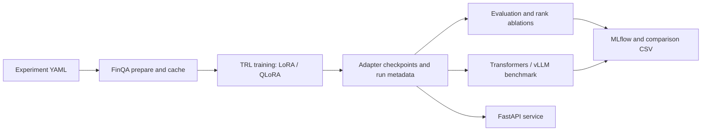

# Efficient LLM Fine-Tuning & Inference Optimization

Research code for controlled FinQA fine-tuning and inference experiments with
`Qwen/Qwen2.5-1.5B-Instruct`. The repository provides baseline evaluation,
LoRA/QLoRA training, fixed-seed rank ablations, MLflow tracking, Transformers
and vLLM benchmarks, and a FastAPI deployment surface.

**No model training or GPU benchmark has been run for this repository yet.**
The results table below is intentionally unpopulated; numbers must come from
the checked-in pipelines and their saved run artifacts.

## Study Design

| Factor | Protocol |
| --- | --- |
| Base model | Qwen2.5-1.5B-Instruct; record an immutable Hugging Face revision for each study |
| Dataset | FinQA authors' train/dev/test JSON at a pinned source commit; persist normalized splits and a source manifest before runs |
| Methods | Zero-shot base model, LoRA, and 4-bit NF4 QLoRA |
| Adapter ablation | Rank 8, 16, 32; same configured seeds and all other settings held fixed |
| Training outputs | Adapter checkpoint, tokenizer, train/eval loss, duration, peak allocated/reserved VRAM, runtime manifest |
| Evaluation | Greedy generation; numeric answer accuracy with a documented relative tolerance; teacher-forced eval loss |
| Inference | Fixed prompt slice, warm-up excluded, configurable batch sizes, Transformers vs. vLLM, optional quantization |
| Tracking | MLflow parameters, scalar metrics, runtime metadata, and JSON artifacts |

The numeric accuracy here is a normalized numeric-answer metric, not a claim of
official FinQA benchmark parity. Preserve the generated prediction files and
state this scoring rule when reporting results. Inference p50/p95 are measured
generation-batch-call latencies for the configured batch size, not per-token
latencies. Throughput includes only measured generation calls and excludes
model loading and warm-up.

### Results

| Method | Rank | Seed(s) | Numeric accuracy | Train loss | Eval loss | Train time | Train / eval peak VRAM | Inference throughput | p50 / p95 latency |
| --- | ---: | --- | ---: | ---: | ---: | ---: | ---: | ---: | ---: |
| Base model | N/A | N/A | Not run | N/A | Not run | N/A | N/A / Not run | Not run | Not run |
| LoRA | 8 / 16 / 32 | Not run | Not run | Not run | Not run | Not run | Not run / Not run | Not run | Not run |
| QLoRA | 8 / 16 / 32 | Not run | Not run | Not run | Not run | Not run | Not run / Not run | Not run | Not run |

Replace “Not run” only with values from `outputs/`, the MLflow run store, and
benchmark JSON files. Keep each row tied to its model/dataset revisions, seed,
method, rank, batch size, backend, quantization, and hardware manifest.

## Architecture



```text
configs/experiment.yaml       Shared model, data, training, adapter, and benchmark settings
src/llm_finetuning/data.py    FinQA normalization, revision checks, prepared dataset artifacts
src/llm_finetuning/training.py TRL SFT, resumable checkpoints, loss/time/VRAM tracking
src/llm_finetuning/evaluation.py Numeric scoring, eval loss, prediction artifacts
src/llm_finetuning/experiments.py Baseline comparison and controlled rank/seed grid
src/llm_finetuning/benchmark.py Transformers/vLLM throughput and latency benchmarks
src/llm_finetuning/api.py     FastAPI single/batch generation and health endpoints
tests/                        CPU-only behavior and API contract tests
```

## Runtime

Use Python 3.10+; Python 3.12 is the tested project target. The full training
and serving stack is designed for Linux with a CUDA-capable NVIDIA GPU. QLoRA
uses Linux `bitsandbytes`; vLLM is an optional Linux/CUDA backend. The checked-in
config pins the model/tokenizer to Hub commit
`989aa7980e4cf806f80c7fef2b1adb7bc71aa306` and the original FinQA GitHub JSON
source to commit `0f16e2867befa6840783e58be38c9efb9229d742`. Change these only as
an explicit experiment factor and retain the exact revisions with the results.
The FinQA Hub builder currently fetches the authors' GitHub `main`; this project
loads the JSON files directly from the pinned source commit to avoid that
mutable indirection.

The authoring machine used to initialize this repository is Windows with an
RTX 3050 (4 GB VRAM), 16 GB system memory, and no Docker installation. That
machine can run the model-free tests but is not used to claim full-model,
QLoRA, or vLLM results. Baseline and LoRA at the configured sequence length may
also exceed 4 GB once activations and generation cache are included. Use a
dedicated Linux GPU host and record its manifest for experiments.

## Install and Test

```powershell
py -3.12 -m venv .venv
.\.venv\Scripts\Activate.ps1
python -m pip install --upgrade pip
python -m pip install -e ".[dev]"
python -m pytest
python -m ruff check src tests
```

For Linux/CUDA training, install the optional QLoRA backend as well:

```bash
python -m pip install -e '.[dev,qlora]'
```

Install vLLM separately in a compatible Linux/CUDA environment:

```bash
python -m pip install -e '.[vllm]'
```

The vLLM/PyTorch/CUDA combination is hardware-sensitive; keep the resolved
environment and runtime manifest with each published experiment. Do not infer
vLLM support from a successful package install alone.

## Experiments

Prepare normalized FinQA once. The prepared cache refuses a metadata mismatch
instead of silently reusing data produced for another dataset revision or seed.

```bash
python -m llm_finetuning --config configs/experiment.yaml prepare
```

Train one adapter method and evaluate the base-model baseline:

```bash
python -m llm_finetuning --config configs/experiment.yaml train --method lora --rank 16
python -m llm_finetuning --config configs/experiment.yaml train --method qlora --rank 16
python -m llm_finetuning --config configs/experiment.yaml evaluate --method baseline
```

Resume a trainer checkpoint with the same method/rank/config:

```bash
python -m llm_finetuning --config configs/experiment.yaml train --method lora --rank 16 --resume-from-checkpoint outputs/finqa-qwen25-15b/lora-r16-s42/checkpoint-100
```

Compare methods or run the rank grid with multiple fixed seeds:

```bash
python -m llm_finetuning --config configs/experiment.yaml compare
python -m llm_finetuning --config configs/experiment.yaml ablate --methods lora,qlora --ranks 8,16,32 --seeds 42,123
```

Evaluate a saved adapter explicitly:

```bash
python -m llm_finetuning --config configs/experiment.yaml evaluate --method lora --model-path outputs/finqa-qwen25-15b/lora-r16-s42
```

Run inference sweeps. For Transformers, quantization accepts `none`, `4bit`, or
`8bit`; bitsandbytes 4/8-bit inference needs Linux/CUDA. vLLM quantization names
must be supported by the installed vLLM release and model checkpoint.

```bash
python -m llm_finetuning --config configs/experiment.yaml benchmark --backend transformers --method lora --model-path outputs/finqa-qwen25-15b/lora-r16-s42 --batch-sizes 1,4,8
python -m llm_finetuning --config configs/experiment.yaml benchmark --backend vllm --method lora --model-path outputs/finqa-qwen25-15b/lora-r16-s42 --batch-sizes 1,4,8
```

Outputs are written under `outputs/`; the MLflow file store defaults to
`mlruns/`. Start the tracking UI with:

```bash
mlflow ui --backend-store-uri mlruns --host 127.0.0.1 --port 5000
```

## API and Docker

Run the API locally after installing project dependencies and setting the model
environment. LoRA/QLoRA requires a saved adapter path.

```powershell
$env:LLM_METHOD = "lora"
$env:MODEL_PATH = "outputs/finqa-qwen25-15b/lora-r16-s42"
$env:API_KEY = "replace-with-a-secret"
uvicorn llm_finetuning.api:app --host 127.0.0.1 --port 8000
```

The service exposes `GET /health`, `POST /generate`, and `POST /generate/batch`.
Send `Authorization: Bearer <API_KEY>` when `API_KEY` is configured. Place
network-level rate limiting, TLS, and secret management in the deployment
gateway; this repository does not claim to provide those infrastructure
controls.

Docker Compose is intended for a Linux Docker host with NVIDIA Container
Toolkit and GPU-enabled Compose support. The included authoring host cannot run
this deployment because Docker is not installed.

```bash
export API_KEY='replace-with-a-secret'
export LLM_METHOD=lora
export MODEL_PATH=/app/outputs/finqa-qwen25-15b/lora-r16-s42
docker compose up --build
```

For vLLM, also set `INSTALL_VLLM=true` and `INFERENCE_BACKEND=vllm` before
building. The vLLM dependency may require a release-specific PyTorch/CUDA
image; verify compatibility on the target host before deploying.

## Reproducibility Checklist

- Pin immutable model, tokenizer, and dataset revisions in the experiment YAML.
- Keep the YAML, prepared data manifest, run JSON, MLflow run, and checkpoint together.
- Use the same seed list and identical data/config for every rank and method.
- Do not compare throughput across machines, precisions, prompt lengths, or generation settings as if controlled.
- Run each benchmark with no competing GPU workload; record the full runtime manifest.
- Report failed/OOM runs and missing metrics; never fill gaps with estimated values.

## Data Attribution

FinQA is distributed under CC BY 4.0 in its Hugging Face dataset card. This
project reads the original authors' public JSON files at the pinned commit
[`czyssrs/FinQA`](https://github.com/czyssrs/FinQA/tree/0f16e2867befa6840783e58be38c9efb9229d742)
and records the source revision in each prepared-data manifest. Cite Chen et
al., “FinQA: A Dataset of Numerical Reasoning over Financial Data,” EMNLP 2021,
when publishing results based on the dataset.
